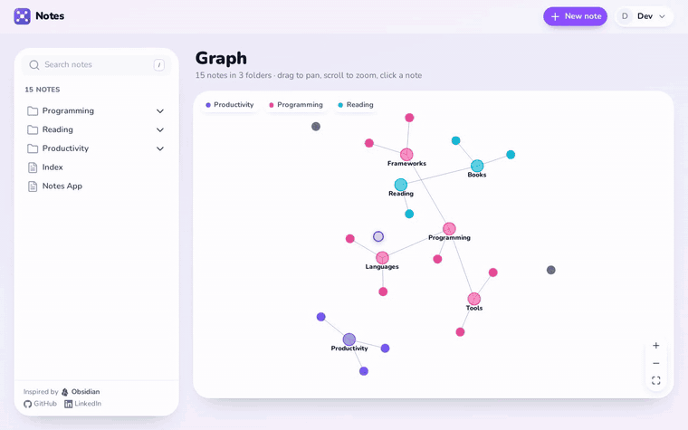

# Notes

<p align="center">
  <br>
  <sub>▶ <a href="preview/demo.mp4">full-resolution MP4</a></sub>
</p>

A self-hosted notes vault: a shared workspace where the people allowed in can
read, create, edit and delete notes.

- **`PRIVATE` notes** are visible and editable only to whoever wrote them.
- **Folders** are implicit: notes carry slash-separated paths.
- **Browsing** is a force-directed graph or a folder tree, and **search**
  across titles and text from the sidebar (`/`).
- **Writing** is Markdown, with a formatting toolbar and a live preview beside it.
- **Visibility** is per note: `PRIVATE`, `PROTECTED` or `PUBLIC`. A note can
  also be shared by link.
- **Public notes** are pre-rendered for search engines.
- **ai-chat** reads and writes the vault through an MCP endpoint, with a
  personal API token.

The note-taking experience is inspired by **[Obsidian](https://obsidian.md)**.
Where Obsidian is a local-first, single-user desktop app, this is a web,
self-hosted, multi-user take on it.

## Stack

- **Server:** Python 3.12, FastAPI, asyncpg (raw SQL), pydantic, structlog.
  - The official MCP SDK serves `/api/mcp`.
  - markdown-it and nh3 do the sanitized pre-render for crawlers.
- **Client:** Vue 3, Vite, TypeScript, [@nuxt/ui](https://ui.nuxt.com) v4
  (through its Vite plugin), Tailwind v4, in the look of the author's other
  apps.
  - marked and DOMPurify render Markdown, and shiki highlights code.
  - d3-force draws the graph.
- **Database:** PostgreSQL with `pg_trgm` for search.
- **Sign-in:** Google, limited to an allow-list of e-mails.

The client is built to static files and served by the server, so one image
runs it all. Architecture and conventions are in [CLAUDE.md](CLAUDE.md) and
[server/AGENTS.md](server/AGENTS.md).

## Configuration

Environment variables. The server refuses to start without the required ones.

| Variable | Required | Purpose |
|---|---|---|
| `NOTES_DATABASE_URL` | ✅ | Postgres connection string |
| `NOTES_JWT_SECRET` | ✅ in the image | Signs session tokens (≥ 32 characters). Rotating it signs everyone out. |
| `NOTES_ALLOWED_EMAILS` | ✅ to let anyone in | Comma-separated e-mails that may sign in. Empty lets nobody in. |
| `NOTES_GOOGLE_CLIENT_ID` | – | Google OAuth client |
| `NOTES_GOOGLE_CLIENT_SECRET` | – | Google OAuth client |
| `NOTES_GOOGLE_REDIRECT_URL` | – | e.g. `https://notes.meizuno.com/api/auth/callback`. Must be registered on the client. All three Google variables or none. |
| `NOTES_SITE_URL` | – | Canonical URL for the sitemap, `<link rel="canonical">` and og tags |
| `NOTES_DEV_LOGIN` | – | Development only: a sign-in without Google. Refused in the image. |
| `PORT` | – | 8080 in the image |

## Development

Everything runs in containers; the host needs only Docker.

```sh
docker compose -f compose.dev.yaml up -d
docker compose -f compose.dev.yaml exec server python scripts/seed.py   # optional sample notes
```

The client is at http://localhost:5173 and the API at http://localhost:8000.
"Log in" opens the dev sign-in (`dev@example.com`, alice or bob); no Google
credentials are needed. In production it goes straight to Google. Behind code-server, see
[CLAUDE.md](CLAUDE.md#development).

| Task | Command |
|---|---|
| Server gate (ruff, mypy, pytest) | `docker compose -f compose.dev.yaml exec server make verify` |
| Client gate | `docker compose -f compose.dev.yaml exec client sh -c 'pnpm build && pnpm typecheck && pnpm test'` |
| Server logs | `docker compose -f compose.dev.yaml logs -f server` |
| Production image | `docker build -t notes .` |

## Deployment

A push to `main` does four things (see `.github/workflows/deploy.yml`):
1. runs both gates;
2. builds `ghcr.io/meizuno/notes`;
3. pushes it;
4. rolls it out with zero downtime on the stack in the infra repo.

Migrations run when the server starts. `/health` (and `/api/health`) answer
503 while `/tmp/drain` exists, which is what the rollout's pre-stop hook
relies on.

### Moving from the central SSO

Earlier versions signed people in through the central auth service. A note's
owner is still the user id that service gave them. Before anyone signs in to
this version, import those users once, keeping their ids, so every `PRIVATE`
note keeps its owner:

```sh
docker compose exec notes python scripts/import_sso_users.py \
  postgres://…/authentication --dry-run   # check, then run without --dry-run
```

It lists any conflicts, and any `PRIVATE`-note owner still without an account.
